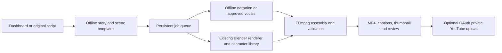

# Toon Pilot

Free-software tools for original nursery songs and simple 3D videos. Use the dashboard to enter lyrics, set song and scene timings, generate or upload audio, listen, and download videos.

## Automated offline production

The existing pipeline now also supports deterministic story/scene planning,
versioned Milo/Pip character selection, offline English/Hindi spoken narration,
portrait/landscape Lite and Quality presets, a persistent retryable queue,
thumbnails and an opt-in private YouTube uploader. **Spoken narration is not
singing.** Natural singing still uses the separate optional engines below.

```bash
python3 -m venv .venv
.venv/bin/python -m pip install -r requirements-scenes.txt
# Install espeak-ng, Blender 4.2+, FFmpeg and FFprobe with your OS package manager.
# This Debian 13 amd64 cloud has a tested rootless speech installer:
bash scripts/install-speech.sh
export PATH=/workspace/tools/bin:$PATH
.venv/bin/python production.py enqueue --request examples/production-small.json
.venv/bin/python production.py worker
.venv/bin/python production.py list
```

For the dashboard, run `.venv/bin/python dashboard.py`, choose language,
characters and format, **Plan scenes automatically**, save, and **Create spoken
narration**. Preview first, then render the full video. Lite is explicitly noisy
but works without OpenImageDenoise; Quality needs a compatible Blender build and
its 1080p rendering speed is unmeasured. Existing manual timing, YAML/rigged
assets, audio uploads, ACE-Step and ArcReel features remain available.



A real 30-second low-resolution narrated sample passed full media decoding;
the latest 180×320/6-fps run took 2:22 with ~276 MiB maximum process/child RSS.
This is not a 1080p or 8 GB EC2 benchmark. The characters remain clearly labeled
starter geometry. YouTube is fixture-tested; live upload needs your OAuth
connection and quota. No GPU model is installed, no public publishing is exposed,
and no recurring scheduler or automatic upload is enabled by default.

See the **[automation guide](docs/automation.md)** for setup, character versions,
daily scheduling, recovery, YouTube OAuth, resource measurements, test evidence
and limitations; **[feature audit](docs/feature-inventory.md)** records the baseline.


## Start here: dashboard on EC2

### 1. EC2 terminal — start the dashboard

For your existing clone:

```bash
cd ~/toon-pilot
git pull
python3 video.py doctor
python3 dashboard.py
```

Leave this terminal running. The dashboard prints `http://127.0.0.1:8768`.

If tools are missing on Ubuntu, install them first:

```bash
sudo apt update
sudo apt install -y python3 git curl ffmpeg blender
```

Rendering needs Blender **4.2 or newer**; check `blender --version`. See [video setup](#create-a-video) if your packaged version is older. The dashboard itself needs no extra Python packages.

### 2. Mac terminal — connect to the dashboard

Run this **on your Mac**, replacing the key path and public IP:

```bash
ssh -i /full/path/to/your-key.pem -N -L 8768:127.0.0.1:8768 ubuntu@YOUR_EC2_PUBLIC_IP
```

Use the full path to the same key you use for EC2 SSH. Keep this terminal open, then open **http://127.0.0.1:8768** in your Mac browser. Do not use the EC2 public IP as the dashboard URL. No extra EC2 security-group port is needed; this uses your existing SSH connection.

Running on your own Linux/Mac computer instead? Run `python3 dashboard.py` in the checkout and open the local URL directly, without a tunnel.

### 3. Browser — create your rhyme

1. Enter the project name, English lyrics, song length (10–120 seconds), tempo and music direction.
2. Open **Scene timing & camera movement**. Set each scene's duration, movement, camera and optional caption. Scene durations must add up to the song length; **Split time evenly** helps.
3. Click **Save rhyme & timing**.
4. Upload your own complete song, or set up AI singing below and click **Generate song**.
5. Listen to the audio. Before rendering, stop ACE-Step in its terminal with Ctrl+C and tick the dashboard's confirmation.
6. Click **Create preview** for a two-second check, then **Create full video** when satisfied. Download audio and videos directly from the dashboard.

A preview without a song uses simple instrumental backing. A full video requires a generated or uploaded song. Saved projects remain in `output/dashboard/`; editing and saving creates a new project to preserve earlier audio.

## Optional: install singing now, test later

Run in **another EC2 terminal**, inside the checkout:

```bash
cd ~/toon-pilot
bash scripts/install-music.sh --check
bash scripts/install-music.sh --download-models
```

The installer is for Linux x86_64. It requires **25 GiB free disk**, installs pinned ACE-Step software and downloads its main model bundle. It does **not** start the server or generate a song. Upstream Linux dependencies include large CUDA packages even though our launcher runs on CPU.

When ready to try singing, run in that EC2 terminal:

```bash
cd ~/toon-pilot
bash scripts/start-music.sh
```

Leave the audio server running while using **Generate song** in the dashboard. Stop it with Ctrl+C before creating videos on your 8 GB machine. The dashboard stays running in its own terminal.

**What is verified:** 25 automated tests, dashboard form/HTTP checks, and a real two-second Blender preview using uploaded synthetic audio. **Still pending:** actual ACE-Step installation/inference on your EC2, singing quality, an 8 GB memory benchmark, and visual dashboard review in a real browser. Voice direction is a prompt, not voice cloning. Exact word-level lyric alignment, spoken narration and automatic YouTube publishing are not implemented. ElevenLabs-level audio quality is not established.

More details: [dashboard and recovery guide](docs/dashboard.md) · [ACE-Step music guide](docs/ace-step.md).

## Command-line tools

The existing runner prepares singing scores, accepts exported vocals or complete songs, renders procedural Milo/Pip characters with preset actions/cameras, and assembles MP4 files. It does not interpret arbitrary story prompts or provide automatic lip sync. The sections below are optional alternatives to the dashboard.

### Prepare a score and instrumental backing

Install Python 3.11+ and Git, then run:

```bash
git clone https://github.com/Vishnu063/toon-pilot.git
cd toon-pilot
python3 audio.py prepare examples/happy_feet.json
```

Windows: use `python` instead of `python3` if needed.

Outputs in `output/audio/`:

- `singing.ust`: 32-second melody with English lyric syllables, intended for OpenUtau import.
- `backing.wav`: quiet, procedural bell-like accompaniment; **not singing**.
- `timing.json`: duration, tempo, and explicit `prepared_not_sung` status.

Preparation replaces these generated files when rerun. Keep custom edits elsewhere.

## Add singing with OpenUtau

1. Download [OpenUtau](https://github.com/openutau/OpenUtau/releases) for your computer. Follow its [getting started guide](https://github.com/openutau/OpenUtau/wiki/Getting-Started).
2. Install an English voicebank whose terms allow your intended use, including monetized YouTube if applicable. No voicebank or model is bundled here. A voicebank is the singer's recorded samples or trained model; the editor alone cannot sing.
3. Open/import `output/audio/singing.ust`, select your singer, and choose its required English phonemizer and renderer. See [phonemizers](https://github.com/openutau/OpenUtau/wiki/Phonemizers). Prefer a lightweight sample-based voicebank for the first 8 GB CPU trial.
4. Preview and correct pronunciation, note splits, pauses, and pitch. The example has one beat per syllable at 60 BPM, plus a rest after each line. Its literal syllables are a starting point, not guaranteed input for every English phonemizer.
5. Export vocals as WAV with the complete timeline, including rests, starting at time zero. Preserve the 32-second alignment.
6. Convert your exported WAV if necessary. With FFmpeg installed:

```bash
ffmpeg -i vocals-export.wav -ar 22050 -ac 1 -c:a pcm_s16le vocals.wav
python3 audio.py mix --vocals vocals.wav --backing output/audio/backing.wav --out output/audio/song.wav
```

Keep vocals and backing within one second of each other; the tool rejects larger mismatches rather than silently truncating. Inputs must be mono 16-bit PCM WAV at 22050 Hz. Output cannot overwrite an input. Listen to the final result before publishing. Automated checks do not judge pronunciation or singing quality.

**OpenUtau import and actual singing have not been tested in this project yet.** Manual export is required; no undocumented headless OpenUtau command is assumed.

## Existing repos we reuse or plan to connect

| Project | Role | Integration status |
|---|---|---|
| [ACE-Step 1.5](https://github.com/ace-step/ACE-Step-1.5) | Complete songs with singing and music | Optional local HTTP adapter; real model inference not yet tested |
| [OpenUtau](https://github.com/openutau/OpenUtau) | Singing editor and voicebank renderer | UST preparation and manual vocal handoff implemented; app import unverified |
| [OpenVPI DiffSinger](https://github.com/openvpi/DiffSinger) | Optional neural singing through compatible OpenUtau voicebanks | Not bundled or tested; optional, model-dependent memory requirements |
| [Your VoiceStudio](https://github.com/Vishnu063/VoiceStudio) | Character speech, narration, and dialogue | Existing separate project; no adapter added yet; not our singing engine |
| [Blender](https://github.com/blender/blender) | Character animation and camera control | Procedural starter characters, action/camera presets, sequential CPU rendering |
| [FFmpeg](https://github.com/FFmpeg/FFmpeg) | Conversion and video assembly | Required for the video runner; optional for audio-only preparation |

OpenUtau is free software. Voicebanks and model weights have separate licenses; inspect their own terms. This starter does not download third-party voices, imitate a real speaker, or bundle third-party assets. An optional [ACE-Step integration](docs/ace-step.md) is now available for experimental local song generation. Its adapter is tested with HTTP fixtures; actual model inference and 8 GB system RAM compatibility are unverified. GPU VRAM figures do not establish compatibility with 8 GB system RAM.

## Your 8 GB computer and EC2

The Python score/backing preparation uses no model or GPU. The video runner generates audio first, then renders scenes sequentially using CPU with two threads by default. It uses no AI video model. OpenUtau performance depends on the voicebank and renderer; 8 GB operation is a target, not a measured guarantee. Use the desktop for the manual singing editor. An EC2 machine without a desktop cannot complete that GUI step using this starter alone. There is no promise of free EC2 compute or unlimited cloud rendering.

## Change the song

Edit `examples/happy_feet.json`: `bpm`, and each note's `lyric`, MIDI `pitch` (60 = middle C), and `ticks` (480 = one beat). `R` represents a rest. English ASCII only in this UST starter. Duration is derived from note lengths and tempo, with a ten-minute cap. Longer scores are supported by preparation, but long vocal generation is untested.

## Verification

```bash
python3 -m unittest discover -s tests -v
```

Thirty local tests cover dashboard input, job failures, uploads/media access and fixture audio-engine integration; audio validation and mixing; installer/launcher control flow with fixture commands; invalid plans; cache fingerprints; actual FFmpeg encoding/assembly/decoding with synthetic fixture frames; an interrupted render; and reuse of completed clips. The fixture renderer is not Blender and does not validate visual quality. These tests do not install ACE-Step dependencies or run OpenUtau, a voicebank, or VoiceStudio. Actual singing still requires a separate audible trial.


## Create a video

Install [Blender 4.2 or newer](https://www.blender.org/download/) and [FFmpeg (including ffprobe)](https://ffmpeg.org/download.html). Add their executable folders to PATH, or supply `--blender /full/path/to/blender`. The Python scripts themselves need no extra pip packages. A graphical desktop is not required for Blender's background CPU rendering.

Check tools and optionally inspect your installed voicebank:

```bash
python3 video.py doctor
python3 video.py doctor --voicebank /path/to/singer --phonemizer "your singer's required phonemizer"
```

Doctor detects executables and common voicebank files. It tells you to select the singer's phonemizer and renderer inside OpenUtau. It cannot verify the app's actual selections, pronunciation, model loadability, or voicebank license. Missing Blender/FFmpeg/FFprobe or a supplied bank without recognizable files returns a failure code. No bank is required for an instrumental preview or an imported complete soundtrack from ACE-Step.

Start with a two-second, low-resolution **instrumental** preview:

```bash
python3 video.py create --preview
```

Procedural characters use explicit Principled surface shaders so their colors render in Cycles, rather than relying on viewport-only colors. Preview frames use 32 samples and full frames use 64, with OpenImageDenoise enabled for the scene and view layer. These settings reduce grain but take longer on CPU. After updating, rerun the preview command: the code fingerprint creates a fresh output folder without reusing older white/grainy frames.

For a real Blender color/denoising regression check (separate from the regular Python tests):

```bash
blender --background --factory-startup --python-exit-code 1 --python tests/blender_render_smoke.py
```

This renders `output/render-smoke/frame.png` and checks shader colors, denoising settings, and visible yellow/blue/green pixels. The fix was checked in Blender 4.2.0; rerender on your EC2 to verify your installed Blender version. The included models remain simple procedural starter characters.

Then create the full 32-second video with your prepared vocal WAV:

```bash
python3 video.py create --vocals vocals.wav
```

To deliberately render without singing:

```bash
python3 video.py create --instrumental
```

The command prints the exact MP4 location inside `output/video/`. Preview uses 256×456 at 12 fps; full output uses 540×960 at 24 fps. Both use simple CPU Cycles rendering with low sample counts. These are lightweight starter visuals, not studio-quality animation; noise and basic geometry are expected. No 8 GB RAM benchmark is claimed. Set `--threads 1` to reduce CPU parallelism; this does not guarantee a particular RAM ceiling.

### Reusable action and camera library

Edit `examples/video.json`. Supported actions are `waddle`, `hop`, `dance`, and `wave`; cameras are `dolly`, `arc`, `pullback`, and `static`. `blender_scene.py` contains reusable functions for these presets and generates simple original duck and bunny geometry. They are not reproductions of an image reference and do not have facial animation or automatic lip sync. The waddle is a simple body translation/bob, not a detailed leg rig.

Each scene may be 0.5–60 seconds, with up to 100 scenes and a total cap of ten minutes. The plan duration must match your song score. Longer video rendering and memory use have not been benchmarked. The first scene supplies the short preview; other scenes are tested by a full render.

### Resume after interruption

Run the same command with identical inputs. Jobs use a fingerprint of the plan, score, vocals or complete soundtrack, runner, audio code, and scene code. Completed clips are checked by FFprobe and fully decoded with FFmpeg before reuse. Existing valid frame images can be reused when a scene is unfinished. Clips are processed one at a time; no parallel model or scene workers are launched.

The output directory contains `status.json` and per-scene `render.log`, `encode.log`, and `verify.log`. A completed job reports `verified_media_needs_human_review`: file checks cannot judge animation quality or whether the singing sounds good. Ctrl+C or a normal failure releases the job lock; after a hard kill, remove only that job's `.running` file once you confirm no render remains active. Two processes cannot intentionally write the same job concurrently.

If frame decoding fails repeatedly, delete the affected generated PNG and retry. If a finished clip fails validation, it is encoded again. Changed inputs use a new job directory. Blender/tool upgrades are not in the fingerprint: use a fresh `--out` directory after upgrading them.


### Validation performed for this update

- Fifteen automated tests passed locally, including real FFmpeg encoding/assembly/decoding with fixture frames and a failed job followed by resume and clip reuse.
- Blender 4.2.0 rendered an actual two-second, 24-frame CPU preview with the included characters. FFprobe and full video decoding passed; a rendered frame was visually inspected.
- Each of the four action/camera pairs rendered two small smoke-test frames in real Blender.
- No full 32-second render, actual English voicebank singing, target-machine 8 GB memory benchmark, or end-to-end sung video has been completed. The two-second preview contains instrumental backing only.


## Optional AI singing and music with ACE-Step

See **[ACE-Step setup and usage](docs/ace-step.md)** for Linux/macOS and Windows instructions. Install its server in a separate environment, force CPU operation and disable its extra language model for the first experiment. No paid API is used. **8 GB RAM operation and reference-level singing quality remain unverified.**

On Ubuntu/Linux x86_64 EC2, install now and test later:

```bash
bash scripts/install-music.sh --download-models
```

This checks for 25 GiB free disk, installs pinned upstream software in `~/.local/share/toon-pilot/ACE-Step-1.5`, and downloads its main model bundle. It does **not** start a server or generate audio. The standard upstream Linux environment includes large CUDA dependencies even though our launcher uses CPU. Use `--check` for a read-only preflight, or omit `--download-models` to install software only. Later, run `bash scripts/start-music.sh` before using `song.py`. Installation on your EC2 and singing inference still need verification.

Once the local server is running:

```bash
python3 song.py
```

This requests a 10-second test song. After listening to it, request the 32-second example and use the complete song in your video:

```bash
python3 song.py --request examples/ace_happy_feet.json --out output/music/happy_feet.wav
python3 video.py create --preview --soundtrack output/music/happy_feet.wav
python3 video.py create --soundtrack output/music/happy_feet.wav
```

Stop the ACE-Step server after generating audio, before starting Blender on an 8 GB machine. `--soundtrack` bypasses vocal mixing and preserves stereo audio; `--vocals` remains for isolated mono vocals from OpenUtau. No automatic lyric-to-action alignment is provided.

The adapter saves a task ID and resumes polling on repeat runs, checks server failures, downloads only from the selected loopback server, and validates audio decoding/duration before saving a completed output. Client timeouts do not cancel server work. The tests used a local fixture server and synthetic audio, not a singing model. An imported stereo 48 kHz soundtrack was tested through real FFmpeg assembly. No actual ACE-Step song has been generated or listened to in this workspace.


## YAML stories, rigged character clips and captions

A focused [anim-studio adaptation](docs/scenes.md) adds optional YAML scenes, named cast/model entries, embedded skeletal clips, a sidecar SRT and selectable MP4 captions. Its small reused rig helper retains the upstream MIT license in `third_party/anim_studio/`. This is a smaller Toon Pilot schema, not a drop-in importer for all upstream story files. No upstream voices, assets, MCP service or branded end card are bundled.

```bash
python3 -m pip install -r requirements-scenes.txt
python3 video.py create --plan examples/happy_feet.scene.yaml --preview
```

The included YAML works with our procedural characters. Your own licensed, self-contained GLB/FBX with one armature and embedded animation can replace them through `cast` and per-scene `characters`; see [the scene guide](docs/scenes.md). Separate motion-file retargeting and automatic lip sync are not implemented. Imported asset memory use depends on mesh/texture size. Captions are selectable, not burned in, and their text/timing must be reviewed against the actual song.


## Optional ArcReel storyboard handoff

[ArcReel](https://github.com/ArcReel/ArcReel) is a separate self-hosted video workspace. Install and start it using its upstream README; it is not bundled with Toon Pilot. Its model services need their own credentials and may cost money. This integration does not provide free unlimited videos.

With ArcReel running, obtain a bearer access token from its `/api/v1/auth/token` endpoint using your ArcReel credentials. Keep that token private; it is different from any local dashboard token. In the terminal that launches Rhyme Studio:

```bash
export ARCREEL_URL=http://127.0.0.1:1241
read -r -s -p 'ArcReel bearer token: ' ARCREEL_TOKEN; echo
export ARCREEL_TOKEN
python3 dashboard.py
```

For a remote instance use HTTPS, with a trusted certificate. URLs must be origins without paths, queries or embedded credentials. Plain HTTP is accepted only for loopback. No additional Python packages are required. Without a token, the existing studio works as before and the optional send button is disabled.

Save a rhyme, then choose **Send brief to ArcReel**. This creates a separate storyboard project named `toon-<local-project-id>` and uploads the original lyrics, music direction and scene timing/action/camera/captions as `source/novel.txt`. It sends no audio or video. Open your ArcReel workspace to review the brief and continue there. The adapter sets `generate_overview=false` and `narration_delivery=post_production`; sending does not request model inference, TTS or video generation. Singing, character consistency and lip sync are not guaranteed. ArcReel output is not automatically imported, rendered by Blender or uploaded to YouTube.

The receipt lives at `output/dashboard/<project-id>/arcreel.json` (or your custom `--out` directory). A successful repeat returns the saved receipt without overwriting ArcReel edits. An incomplete/uncertain attempt blocks resubmission, including after restart. Inspect the named project and its source in ArcReel, and finish the transfer manually if needed; do not blindly delete the receipt and resend. The receipt records the attempt phase, never the token. The original local rendering workflow is unchanged.

The adapter is checked against ArcReel source revision `43bc1575f1cf60318769476a04d219ab7233dc42` and tested with a local HTTP contract fixture, including a lost upload response, refused authentication, redirects and repeat protection. A live ArcReel installation and actual provider generation have not been tested here.
